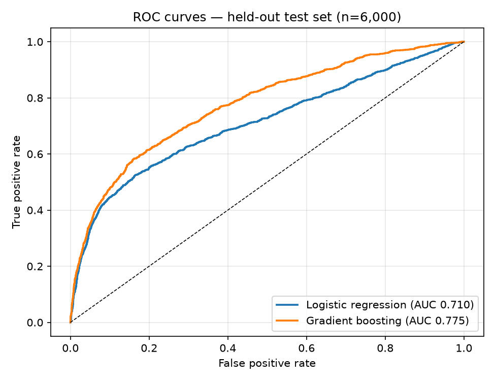
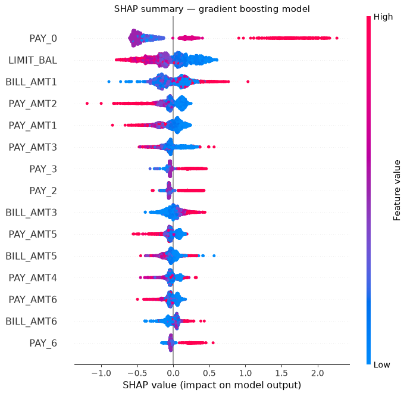
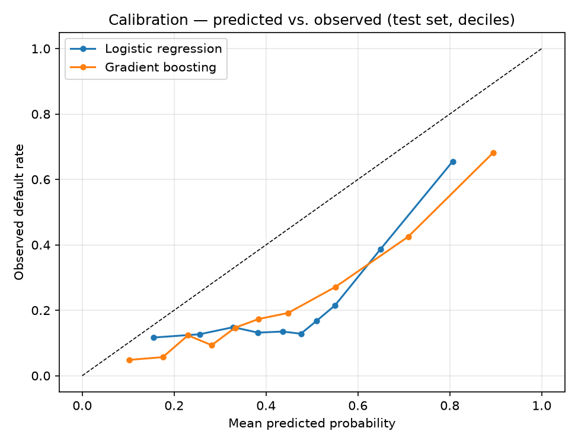

# ML Credit-Risk Classifier with Explainability

**Archit Chawla**

Predicting next-month credit-card default on 30,000 real borrowers — a logistic-regression baseline benchmarked honestly against XGBoost gradient boosting, with SHAP explanations of what actually drives the predictions.

**Headline results (held-out test set, n = 6,000):**

| | Logistic regression | XGBoost |
|---|---|---|
| Test AUC | 0.710 | **0.775** |
| Test KS | 0.360 | **0.422** |
| Recall @ operating threshold | 0.48 | **0.68** |

Top default driver (SHAP): the most recent month's repayment status — more than twice the weight of any other feature. Full detail in `model_card.md`; the story in `credit_risk_report.md`.

## Charts



*ROC curves on the held-out test set: XGBoost (AUC 0.775) separates defaulters from non-defaulters materially better than the logistic baseline (0.710).*



*SHAP summary: the most recent month's repayment status (PAY_0) dominates — recent payment behavior, not demographics, drives the risk ranking.*



*Calibration by decile: the ranking is sound, but raw probabilities run hot under class weighting — recalibration would be needed before pricing use.*

## What's in here

| File | What it is |
|---|---|
| `train.py` | The whole pipeline: load → clean → split → train → evaluate → explain → charts. Seeded (42) and rerunnable; a second clean run reproduces `results.json` exactly |
| `results.json` | Every reported metric: CV AUCs, test AUC/KS, threshold metrics, confusion matrices, calibration stats, SHAP top-10 |
| `model_card.md` | Dataset provenance, method, results table, explainability findings, fairness notes, limitations |
| `credit_risk_report.md` | Short analyst writeup: question, approach, findings, what the explanations add, honest limits |
| `charts/` | `roc_curves.png`, `calibration.png`, `shap_summary.png` |
| `requirements.txt` | Pinned environment (scikit-learn 1.9.1, XGBoost 2.0.3, shap 0.54.1) |

## Run it

```bash
python3 -m venv .venv && source .venv/bin/activate
pip install -r requirements.txt
python train.py
```

## Data

UCI Machine Learning Repository, dataset 350, "Default of Credit Card Clients" (Yeh & Lien, 2009): 30,000 Taiwanese credit-card clients, April–September 2005 behavior, target = default the following month; base rate 22.12%.

The raw file (`data/default of credit card clients.xls`, ~5.5 MB) exceeds GitHub's contents-API size limit, so it is **not in this repo**. Download it from https://archive.ics.uci.edu/dataset/350/default+of+credit+card+clients and place the `.xls` in `data/` — `train.py` expects exactly that path.

## Method in one paragraph

Stratified 80/20 split (seed 42); preprocessing fit on train only; class imbalance handled with class weights (no resampling); operating threshold selected on training predictions via Youden's J, then frozen; evaluation on AUC, KS, precision/recall/F1 at that threshold, Brier score and decile calibration error; explainability via SHAP TreeExplainer (permutation-importance fallback built into `train.py`, labeled as such if used).

## Limitations

2005 Taiwanese card data — a methods demonstrator, not a US lending model. Raw predicted probabilities run hot under class weighting and would need recalibration before pricing use. Demographic features are inputs; no formal fairness testing is performed. See `model_card.md` for the full discussion.

*Independent research project. Not investment or lending advice.*
